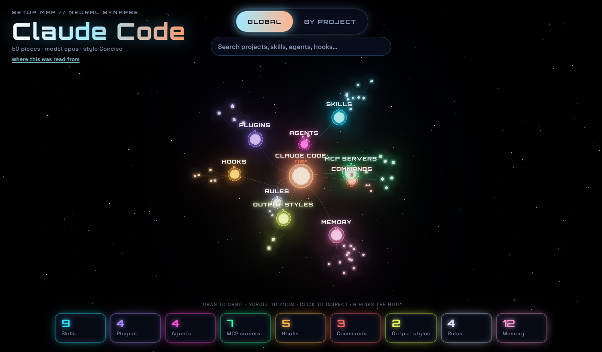
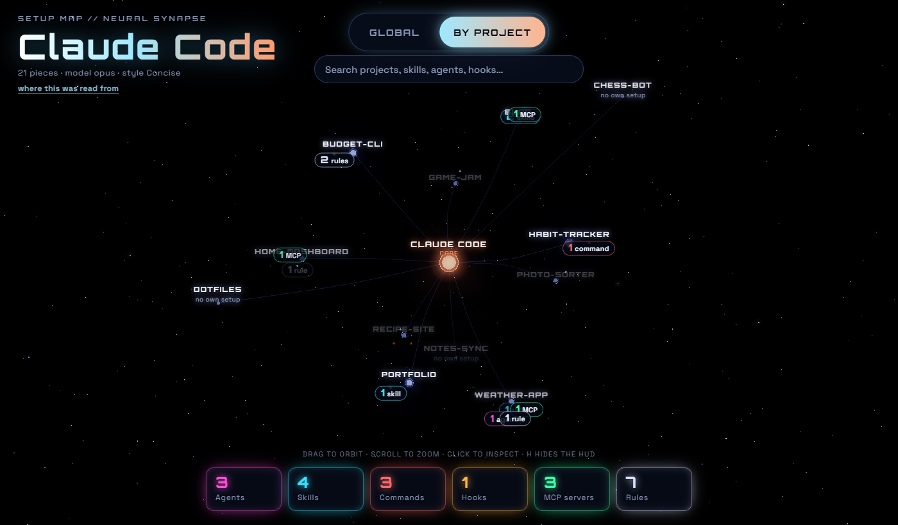

# setup-map

Draws your [Claude Code](https://docs.claude.com/en/docs/claude-code) setup as an
interactive 3D map: skills, plugins, agents, MCP servers, hooks, commands, output
styles, rules and memory around a glowing core, and a second view of your projects
showing which ones have a setup of their own. Click anything to see what it is, or
search for it by name.





The screenshots come from a made-up sample setup, not a real one.

Two ways to use it:

- [`skill/`](skill/): an installable Claude Code skill. Runs fixed, tested code and
  gives the same page every time.
- [`prompt.md`](prompt.md): a single prompt you paste into Claude Code, no install.
  Claude writes the code fresh each time, so the page's look can vary.

## What it touches

- Reads `~/.claude` (skills, agents, commands, output styles, rules, plugins, hooks,
  memory folders), `~/.claude.json` (MCP server names) and each project's own
  `.claude` folder, `CLAUDE.md` and `.mcp.json`.
- Takes only names, short descriptions (the `description` line at the top of a skill
  or agent file) and counts. It never copies settings values, environment variables,
  hook commands, URLs or the contents of your memory files.
- Writes one local HTML file, `~/setup-map/setup-map.html`. Nothing else is written.
- Sends nothing anywhere. When you open the page, it loads three.js from jsDelivr and
  its fonts from Google Fonts; your setup stays inside the file.

The page shows your project and skill names, so think before you share it.

## Install the skill

Copy the `skill` folder to `~/.claude/skills/setup-map`, so you end up with
`~/.claude/skills/setup-map/SKILL.md`. The folder must be named `setup-map`. Python 3
is required. Start a new Claude Code session.

```sh
git clone https://github.com/ZazaGdev/AI-fun.git
cp -r AI-fun/setup-map/skill ~/.claude/skills/setup-map
```

## Use

Start Claude Code in the folder that holds your projects, then type:

```
/setup-map
```

Or name the folder:

```
/setup-map ~/code
```

It looks for projects in that folder and its subfolders, three levels deep. A folder
counts as a project when it has a `.git`, `.claude`, `CLAUDE.md` or `.mcp.json`.

You can also run the script directly, on Windows, macOS or Linux:

```sh
python ~/.claude/skills/setup-map/scripts/setup_map.py ~/code --open
```

Options: `--out <file>` writes the page somewhere else; `--projects-json <file>` also
reads a JSON list of projects kept elsewhere, in the form
`{"projects": [{"name": "...", "path": "..."}], "scanRoots": ["..."]}`, where every
folder in a scan root counts as a project.

In the page: drag to orbit, scroll to zoom, click a node or a chip to open its list,
switch between Global and By project at the top, and press H to hide the overlay.

## Or just paste the prompt

Open [`prompt.md`](prompt.md), copy everything between the two markers into Claude
Code and set the projects folder on its first line. It reads the same things and
writes the same kind of page.
